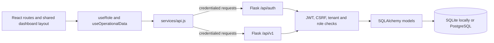

# Occupie architecture (current code audit)

**Audited:** 2026-10-11. This document describes the checked-in application code, not planned features. On Windows, `architecture.md` and the existing tracked `ARCHITECTURE.md` resolve to the same file.

## Stack and request flow

The browser application uses React 18, Vite, Tailwind CSS, and React Router 6. The API uses Flask 3, Flask-CORS, Flask-SQLAlchemy, Flask-Migrate, Flask-JWT-Extended, and Flask-Limiter. Development defaults to SQLite; `DATABASE_URL` selects PostgreSQL, which is required by the production configuration.

The frontend API client uses a short-lived HTTP-only JWT access cookie, sends the companion CSRF cookie in `X-CSRF-TOKEN` for writes, and returns 401 responses without a refresh attempt. `useRole` restores the current user through `/api/auth/me`. In local development, Vite proxies `/api/*` to Flask at `127.0.0.1:5000` so the browser uses a same-origin API URL. Operational dashboards use `useOperationalData` to load tables, reservations, and waitlist entries in parallel. Explicit development demo mode uses `mockData.js`; production builds always use API mode.

## Frontend responsibilities and modules

| Boundary | Current responsibility | Main files |
|---|---|---|
| App composition and routes | Browser router, role context, public/auth routes, dashboard routes, client-side role gates | `frontend/src/App.jsx`, `frontend/src/routes/AppRoutes.jsx`, `frontend/src/hooks/useRole.jsx` |
| Shared workspace shell | Sidebar navigation, top bar, mobile sidebar, hash-anchor scrolling, demo-only role switcher | `frontend/src/components/layout/` |
| Reusable UI | Cards, inputs, buttons, badges, empty states, page entrance and status display | `frontend/src/components/ui/`, `frontend/src/components/common/` |
| API and operations state | Cookie/CSRF fetch wrapper, auth and operational endpoint methods, dashboard data refresh and mutations | `frontend/src/services/api.js`, `frontend/src/hooks/useOperationalData.jsx` |
| Allocation rules | Customer booking recommendations call the API; host/manager queue suggestions also run a browser-side helper over loaded data. Seating mutations are rechecked by the API. | `frontend/src/services/allocation.js`, `backend/app/services/allocation.py` |
| Role workspaces | Manager, host, floor staff, and customer screens | `frontend/src/pages/dashboards/{manager,host,floor-staff,customer}/` |
| Public and account pages | Landing page, login, customer registration and demo role selection | `frontend/src/pages/landing/`, `frontend/src/pages/auth/` |

The landing page's floor-plan illustration uses fixture data. Fixture data in the landing story is presentation-only; operational API mode reports live API failures and does not silently switch to mock success.

## Route and layout model

`AppRoutes.jsx` defines the public, account, and `/dashboard/*` routes. All dashboard routes share `DashboardLayout`, which contains `RoleSwitcherBanner`, `Sidebar`, and `Topbar`, then renders the selected page through a React Router `Outlet`. Manager, host, floor staff, and customer pages are separate modules. The customer booking, upcoming, and history URLs reuse `CustomerDashboard` with a page prop.

`DashboardAccess` waits for session restoration, sends signed-out users to `/auth/login`, and redirects authenticated users who visit a different role's route to the route associated with their server-reported role. `DashboardIndexRedirect` sends an authenticated user to that role's workspace. These browser checks improve navigation but are not a security boundary: Flask independently enforces authentication, restaurant membership, operation role, and customer ownership. Only the explicit local demo mode bypasses the role match at the client gate; the demo role selector is itself hidden in API mode.

See [sitemap.md](sitemap.md) for every route and sidebar destination.

## Authentication and authorization

`backend/app/routes/auth.py` exposes public customer registration and login, access-cookie logout and current-user restoration, plus a public restaurant list. Passwords use Werkzeug scrypt hashes. A short-lived access JWT is set in an HTTP-only cookie; a separate CSRF cookie is echoed in `X-CSRF-TOKEN` for state-changing requests. Logout revokes that access token through `revoked_tokens`. Verification, password recovery, and refresh-token endpoints are not registered. Their historical database columns remain mapped so the existing schema and rows can be preserved without a cleanup migration.

Operational requests in `backend/app/routes/operations.py` require an access JWT. The server resolves a restaurant from `X-Restaurant-ID`, `restaurant_id`, JSON `restaurantId`, or `DEFAULT_RESTAURANT_ID`; it then resolves staff roles from `RestaurantMembership`. A user without a matching staff membership is treated as a customer. Customer reservation and waitlist records are constrained to the signed-in user. Public registration cannot assign staff membership; `flask provision-staff` is the trusted provisioning path.

The backend supports restaurant selection, but the current browser client sends no restaurant selector and the shared sidebar displays a hardcoded restaurant name. In practice, normal UI requests use the configured default restaurant. `/api/auth/restaurants` is public, but no current page consumes it as a tenant picker.

## Backend feature boundaries

| Boundary | Responsibility | Main files |
|---|---|---|
| App and configuration | Flask factory, extension setup, CORS, error/JWT handlers, development schema convenience, staff provisioning CLI | `backend/app/__init__.py`, `backend/app/config.py`, `backend/run.py` |
| Auth and request protection | Auth endpoints, JWT cookie behavior, CSRF, role decorator | `backend/app/routes/auth.py`, `backend/app/middleware/auth.py` |
| Operational REST API | Tenant resolution, permissions, validation, allocation recheck, state updates and audit writes | `backend/app/routes/operations.py` |
| Allocation rules | Deterministic single-table fit and reservation hold-window rules | `backend/app/services/allocation.py` |
| Models | User, restaurant/membership, table, reservation, waitlist, revoked token and audit event | `backend/app/models/` |
| Schema history | Alembic revisions for original-schema upgrade, membership backfill, audit events, constraint cleanup, duplicate booking constraint | `backend/migrations/versions/` |

`backend/app/__init__.py` registers the operational blueprint at `/api/v1`, auth at `/api/auth`, and the health blueprint at both `/api` and `/api/v1`. The older `backend/app/routes/allocations.py`, `reservations.py`, and `tables.py` modules are not registered. Their routes are not current public API contracts; the registered operations routes supersede them.

## Database model and relationships

| Model | Stored data and links |
|---|---|
| `User` | Unique email, scrypt password hash, legacy/base role, historical verification/reset columns, and `auth_version`. Historical columns are retained for compatibility but are not read or written by the simplified auth routes. IDs are referenced by reservations, waitlist creators, memberships, audit actors, and revoked-token validation. |
| `Restaurant` | Tenant ID and name. Parent tenant referenced by memberships, tables, reservations, waitlist rows, and audit events. |
| `RestaurantMembership` | Composite `(user_id, restaurant_id)` key and staff role restricted to manager, host, or floor staff. |
| `RestaurantTable` | Tenant-scoped capacity, section, status, assigned server, current party size, and seating timestamp. |
| `Reservation` | Tenant, optional customer owner, guest details, party size, UTC start, optional table, status, and notes/preferences. SQLAlchemy relationships link it to `RestaurantTable` and `Restaurant`. A partial unique index prevents a customer's duplicate active booking for the same restaurant and timestamp. |
| `WaitlistEntry` | Tenant, optional creator, party/contact, status, creation time, and optional table. SQLAlchemy links it to the table. |
| `RevokedToken` | Revoked JWT ID and expiry. |
| `AuditEvent` | Tenant, optional actor, entity/action, JSON details, timestamp. Mutating operational endpoints record relevant table, reservation, and waitlist events. |

Current status values are `available`, `occupied`, `reserved`, `cleaning` for tables; `confirmed`, `checked_in`, `seated`, `cancelled`, `no_show` for reservations; and `waiting`, `ready`, `seated`, `cancelled` for waitlist entries.

Migrations are present and the repository documentation says the initial revision carries original local operational rows into restaurant-scoped tables. Development also has an `AUTO_CREATE_SCHEMA` convenience path for an empty schema. This audit did not apply migrations or alter the database. Continue to use `flask db upgrade` for schema changes and preserve existing database files and records.

## Current operational limits

- Allocation chooses one currently available table with enough seats, preferring the requested section and then the smallest sufficient capacity. A larger table handles a non-exact capacity; combining tables is not implemented.
- Host and manager dashboard suggestions use a separate browser helper that reduces reservation timestamps to time-of-day. The server rechecks seating mutations, but the displayed recommendation can disagree with the API's full-datetime allocation rule, especially across dates.
- Confirmed and checked-in reservations protect their assigned table within a 90-minute window. Occupied, reserved, and cleaning tables are not recommendations for a new booking. Reservation creation rechecks the chosen table and takes row locks where the database supports them.
- PostgreSQL row locks provide the intended concurrent allocation protection. SQLite does not enforce `SELECT ... FOR UPDATE`; tests against SQLite do not prove production concurrency behavior.
- There is no occupied-table turnover prediction, automatic late-arrival/no-show transition, notification push, analytics/revenue endpoint, or server-side reporting API. The manager's CSV export is generated in the browser from currently loaded records; preview-only KPI values are labeled demo data.
- Customer waitlist refresh is polled by the page; the top bar polls health. Neither is a live operational push channel.

See [workflows.md](workflows.md) and [api-contract.md](api-contract.md) for the verified flow and route details.
