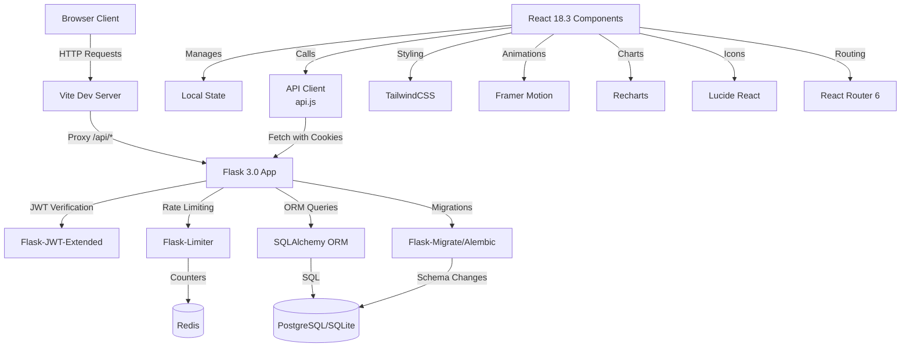

# Occupie: Complete Project Technical and Functional Report

**Project Name:** Occupie — Restaurant Seating Operations  
**Version:** 0.1.0  
**Report Date:** October 10, 2026  
**Implementation Status:** Production-Ready Core System  

---

## Table of Contents

1. [Project Overview](#chapter-1-project-overview)
2. [Complete System Workflow](#chapter-2-complete-system-workflow)
3. [Technology Stack](#chapter-3-technology-stack)
4. [Frontend Architecture](#chapter-4-frontend-architecture)
5. [Every Page and Feature](#chapter-5-every-page-and-feature)
6. [Authentication and Authorization](#chapter-6-authentication-and-authorization)
7. [Backend Architecture](#chapter-7-backend-architecture)
8. [Complete REST API Reference](#chapter-8-complete-rest-api-reference)
9. [Database Design](#chapter-9-database-design)
10. [Adaptive Seating and Optimization Algorithm](#chapter-10-adaptive-seating-and-optimization-algorithm)
11. [Role-Based Functional Workflows](#chapter-11-role-based-functional-workflows)
12. [Analytics and Evaluation](#chapter-12-analytics-and-evaluation)
13. [Testing and Quality Assurance](#chapter-13-testing-and-quality-assurance)
14. [Installation and Execution](#chapter-14-installation-and-execution)
15. [Deployment Architecture](#chapter-15-deployment-architecture)
16. [Troubleshooting Guide](#chapter-16-troubleshooting-guide)
17. [Security, Reliability and Limitations](#chapter-17-security-reliability-and-limitations)
18. [Future Improvements](#chapter-18-future-improvements)
19. [Demo and Presentation Walkthrough](#chapter-19-demo-and-presentation-walkthrough)
20. [Final Implementation Status](#chapter-20-final-implementation-status)

---

## Chapter 1: Project Overview

### 1.1 Full Project Title and Purpose

**Occupie** is an intelligent restaurant seating operations platform that helps restaurant staff coordinate tables, reservations, walk-ins, and waitlist management. The system uses adaptive allocation algorithms to optimize table assignments, reduce wait times, and improve operational efficiency.

**Tagline:** Adaptive Seating Intelligence for Smart Restaurants

### 1.2 Problem Statement

Restaurants face significant operational challenges in managing their dining rooms:

1. **Inefficient Table Allocation**: Manual seating decisions often result in suboptimal table utilization, with large tables assigned to small parties while other guests wait.

2. **Poor Wait Time Management**: Without data-driven insights, hosts struggle to provide accurate wait times, leading to customer frustration and lost revenue.

3. **Coordination Overhead**: Multiple staff roles (hosts, floor staff, managers) need real-time visibility into table status, reservations, and waitlist, but often rely on paper systems or fragmented tools.

4. **Revenue Loss**: Suboptimal seating leads to:
   - Idle capacity during peak hours
   - Longer customer wait times
   - Table turnover inefficiency
   - No-show and late-arrival mismanagement

5. **Limited Visibility**: Managers lack comprehensive analytics to understand seating patterns, utilization rates, and operational bottlenecks.

### 1.3 Proposed Solution

Occupie provides a **unified, role-based platform** that:

- **Adaptive Seating Engine**: Multi-factor scoring algorithm considers capacity fit, wait impact, idle time, and revenue opportunity to recommend optimal table assignments.

- **Real-Time Operations**: Live table status, reservation management, and waitlist coordination accessible to all staff roles simultaneously.

- **Customer Self-Service**: Guests can book reservations, check-in online, and view their dining history through a customer portal.

- **Predictive Insights**: Analytics dashboard helps managers identify patterns and optimize operations (foundation implemented, full analytics planned).

- **Flexible Policies**: Configurable allocation weights allow restaurants to optimize for different priorities (revenue, turnover, capacity utilization).

### 1.4 Project Objectives

**Primary Objectives:**
1. Provide intelligent table allocation recommendations based on multi-factor scoring
2. Enable seamless coordination between customer, host, floor staff, and manager roles
3. Reduce average customer wait times through optimized seating
4. Improve table utilization and revenue per seat
5. Create audit trails for all operational decisions

**Secondary Objectives:**
1. Provide foundational analytics for operational insights
2. Support multiple restaurants with tenant-scoped data
3. Enable secure, role-based access with proper authentication
4. Maintain system reliability with comprehensive testing
5. Support both real-time API mode and offline demo mode

### 1.5 Intended Users

**Customer (Dining Guests)**
- Public users who register for accounts
- Can book reservations, check-in online, view upcoming bookings and history
- Join waitlist for walk-in seating

**Host / Receptionist**
- Front-of-house staff managing arrivals
- View all reservations and waitlist
- Get seating recommendations from adaptive engine
- Confirm table assignments and manage walk-in queue

**Floor Staff**
- Service staff assigned to dining room sections
- Update table status (occupied, available, cleaning)
- View assigned tables and current occupancy

**Manager**
- Restaurant administrators with full access
- Configure tables and sections
- View analytics and operational metrics
- Generate shift reports
- Manage allocation policies

### 1.6 Expected Benefits

**For Customers:**
- ✅ Convenient online booking and check-in
- ✅ Reduced wait times through optimized allocation
- ✅ Transparency into reservation status
- ✅ Self-service waitlist management

**For Restaurant Staff:**
- ✅ Data-driven seating recommendations
- ✅ Real-time coordination across all roles
- ✅ Reduced manual coordination overhead
- ✅ Clear audit trail for accountability

**For Restaurant Operations:**
- ✅ Improved table utilization (minimize wasted capacity)
- ✅ Increased revenue per table through better allocation
- ✅ Reduced no-show impact with check-in tracking
- ✅ Foundation for predictive analytics

### 1.7 Project Scope and Limitations

**In Scope (Implemented):**
- ✅ Multi-role authentication and authorization
- ✅ Adaptive table allocation with configurable scoring
- ✅ Reservation creation, management, and lifecycle tracking
- ✅ Waitlist queue management with priority enforcement
- ✅ Table status management across roles
- ✅ Customer booking portal with self-service features
- ✅ Host seating recommendations dashboard
- ✅ Manager analytics overview and shift reporting
- ✅ Comprehensive test coverage (77 passing tests)
- ✅ Audit logging for operational events
- ✅ Production-ready security (JWT, CSRF, rate limiting)

**In Scope (Foundation Present, Limited Implementation):**
- ⚠️ Analytics metrics (current-state KPIs, historical data collection planned)
- ⚠️ Multi-restaurant support (data model supports it, UI enforces single restaurant)
- ⚠️ Email notifications (SMTP configuration present, active flows removed)

**Out of Scope (Planned Future Work):**
- ❌ Table turnover prediction based on historical data
- ❌ Real-time push notifications (WebSocket/SSE)
- ❌ Advanced machine learning for wait time estimation
- ❌ POS system integration
- ❌ Payment processing
- ❌ SMS notifications for waitlist updates
- ❌ Multi-table combination for large parties
- ❌ Automatic no-show detection and recovery

**Technical Limitations:**
- SQLite in development lacks PostgreSQL row-level locking (production requires PostgreSQL)
- Short JWT expiry (15 minutes) with no refresh token mechanism
- Single-restaurant enforcement in UI despite multi-tenant data model
- Manual refresh required for waitlist and table updates (no live push)
- Client-side analytics charts use demo data, not historical API data

---

## Chapter 2: Complete System Workflow

### 2.1 Application Lifecycle Overview

```
┌─────────────┐      ┌──────────────┐      ┌─────────────┐
│   Browser   │─────▶│ React + Vite │─────▶│ Flask API   │
│   Access    │      │  Frontend    │      │   Backend   │
└─────────────┘      └──────────────┘      └─────────────┘
                            │                       │
                            │                       │
                            ▼                       ▼
                     ┌──────────────┐      ┌─────────────┐
                     │  Local State │      │  PostgreSQL │
                     │  (Demo Mode) │      │  / SQLite   │
                     └──────────────┘      └─────────────┘
```

### 2.2 Opening the Public Website

**Step 1: Navigate to Landing Page**
- User visits `http://localhost:5173` (development) or production domain
- React Router loads `LandingPage.jsx`
- Vite dev server proxies `/api/*` requests to Flask at `http://127.0.0.1:5000`

**Step 2: Landing Page Rendering**
- `LandingPage.jsx` component mounts
- GSAP animation engine initializes
- Displays:
  - Occupie branding with animated logo
  - Product value proposition
  - Call-to-action buttons: "Sign In" and "Get Started"
  - Floor plan visualization (fixture data, presentation only)
  - Feature highlights

**Step 3: Navigation Options**
- **Sign In**: Routes to `/auth/login`
- **Get Started**: Routes to `/auth/register`
- **Demo Mode**: If `VITE_DATA_MODE=demo` in `.env`, uses local fixtures instead of API

### 2.3 Registration and Sign-In

#### Registration Flow (`/auth/register`)

**Frontend (`AuthActionPage.jsx`):**
1. User enters: Name, Email, Password
2. Client validates:
   - Name: 1-120 characters
   - Email: Valid RFC pattern
   - Password: 12-128 characters
3. Form submission calls `apiService.auth.register()`

**API Request:**
```javascript
POST /api/auth/register
Content-Type: application/json

{
  "name": "John Smith",
  "email": "john@example.com",
  "password": "SecurePassword123!"
}
```

**Backend Processing (`auth.py` line 88):**
1. Rate limiter checks: 5 registrations per hour allowed
2. Validates input:
   - Name: non-empty, ≤120 chars
   - Email: matches `EMAIL_PATTERN` regex, ≤120 chars
   - Password: 12-128 characters
3. Normalizes email to lowercase
4. Checks for duplicate: `User.query.filter_by(email=normalized_email).first()`
5. Creates `User` object:
   - `role='customer'` (always, ignores any submitted role)
   - `password_hash=generate_password_hash(password, method='scrypt')`
6. Commits to database with IntegrityError handling
7. Returns `201 {"message": "Account created. You can now sign in."}`

**Database Write:**
```sql
INSERT INTO users (name, email, password_hash, role, auth_version, created_at)
VALUES ('John Smith', 'john@example.com', '<scrypt-hash>', 'customer', 1, <timestamp>);
```

#### Login Flow (`/auth/login`)

**Frontend (`LoginPage.jsx`):**
1. User enters: Email, Password
2. Form submission calls `apiService.auth.login()`

**API Request:**
```javascript
POST /api/auth/login
Content-Type: application/json

{
  "email": "john@example.com",
  "password": "SecurePassword123!"
}
```

**Backend Processing (`auth.py` line 126):**
1. Rate limiter checks: 10 logins per 15 minutes allowed
2. Queries user: `User.query.filter_by(email=email.strip().lower()).first()`
3. Verifies password: `user.check_password(password)` using Werkzeug `check_password_hash()`
4. Resolves role from `RestaurantMembership`:
   - Queries `DEFAULT_RESTAURANT_ID` membership
   - If found: `role = membership.role` (manager/host/floor_staff)
   - If not found: `role = 'customer'`
5. Creates JWT access token:
   - `identity=str(user.id)`
   - `additional_claims={'auth_version': user.auth_version}`
   - Expiry: 15 minutes (900 seconds)
6. Sets HTTP-only cookies:
   - `occupie_access`: JWT token
   - `occupie_csrf_access`: CSRF token for mutation protection
7. Returns `200` with user profile:

```json
{
  "user": {
    "id": 1,
    "name": "John Smith",
    "email": "john@example.com",
    "role": "customer",
    "restaurantId": "default",
    "created_at": "2026-10-10T10:00:00Z"
  }
}
```

**Frontend State Update:**
1. `useRole` hook receives response
2. Updates context: `setUser(result.data.user)`
3. Stores authentication state
4. Redirects to dashboard: `/dashboard/customer`

### 2.4 Authentication and Role Resolution

**Session Restoration on Page Load:**

**Frontend (`useRole.jsx` line 23):**
```javascript
useEffect(() => {
  if (isDemoMode) {
    // Use local demo user
    setUser(DEMO_USERS[demoRole]);
    return;
  }
  
  // Restore from JWT cookie
  apiService.auth.restore().then((result) => {
    setUser(result.success ? result.data.user : null);
    setAuthError(result.success ? null : result.error);
    setLoading(false);
  });
}, [demoRole]);
```

**API Request:**
```javascript
GET /api/auth/me
Cookie: occupie_access=<jwt-token>
```

**Backend Processing (`auth.py` line 162):**
1. `@jwt_authenticated` decorator verifies JWT cookie
2. Extracts user ID from JWT payload: `get_current_user()`
3. Queries database: `db.session.get(User, int(jwt_payload['sub']))`
4. Validates `auth_version` matches JWT claim (invalidates if password changed)
5. Resolves current role from membership
6. Returns user profile

**JWT Validation (`__init__.py` line 62):**
```python
@jwt.token_in_blocklist_loader
def is_token_revoked(jwt_header, jwt_payload):
    # Check revocation table
    if RevokedToken.query.filter_by(jti=jwt_payload['jti']).first():
        return True
    # Check auth version
    user = db.session.get(User, int(jwt_payload['sub']))
    return not user or jwt_payload.get('auth_version') != user.auth_version
```

### 2.5 Opening the Correct Role-Specific Workspace

**Route Protection (`AppRoutes.jsx` line 10):**
```javascript
function DashboardAccess({ role, children }) {
  const { loading, isAuthenticated, isDemoMode, currentRole } = useRole();
  
  // Wait for session restoration
  if (loading) return <LoadingScreen />;
  
  // Require authentication
  if (!isAuthenticated) return <Navigate to="/auth/login" replace />;
  
  // Role match enforcement (demo mode allows any role)
  if (!isDemoMode && currentRole !== role) {
    return <Navigate to={ROLE_CONFIGS[currentRole]?.route} replace />;
  }
  
  return children;
}
```

**Dashboard Routing:**
- Customer (role='customer') → `/dashboard/customer`
- Host (role='host') → `/dashboard/host`
- Floor Staff (role='floor_staff') → `/dashboard/floor-staff`
- Manager (role='manager') → `/dashboard/manager`

**Layout Rendering (`DashboardLayout.jsx`):**
```javascript
<div className="occupie-dashboard">
  <RoleSwitcherBanner />  {/* Demo mode only */}
  <Sidebar isOpen={sidebarOpen} />
  <div className="main-content">
    <Topbar onMenuClick={...} />
    <main>
      <Outlet />  {/* Role-specific dashboard component */}
    </main>
  </div>
</div>
```

### 2.6 Performing Role-Specific Operations

#### Example: Customer Creates Reservation

**Step 1: Navigate to Booking Page**
- Customer clicks "Book a Table" in sidebar
- Router navigates to `/dashboard/customer/book`
- Renders `<CustomerDashboard page="booking" />`

**Step 2: Fill Booking Form**
- Party size: 4
- Date/time: 2026-10-12 19:30
- Seating preference: "Patio"
- Phone: Optional
- Notes: Optional

**Step 3: Check Availability**
```javascript
// frontend/src/hooks/useOperationalData.jsx line 230
const recommendReservation = async ({ partySize, startsAt, seatingPreference }) => {
  const result = await apiService.allocations.getRecommendations({
    partySize,
    at: startsAt,
    preferredSection: seatingPreference,
  });
  return result;
};
```

**API Request:**
```
GET /api/v1/allocations/recommend?party_size=4&at=2026-10-12T19:30:00Z&preferred_section=Patio
Cookie: occupie_access=<jwt>
```

**Backend Processing (`operations.py` line 558):**
1. Validates JWT and resolves restaurant/role
2. Parses query parameters
3. Loads all restaurant tables: `RestaurantTable.query.filter_by(restaurant_id=...)`
4. Loads active reservations: `Reservation.query.filter(...status in ['confirmed', 'checked_in'])`
5. Calls adaptive allocation engine:

```python
from app.services.adaptive_allocation import recommend_tables

recommendations = recommend_tables(
    tables=tables,
    party_size=4,
    reservations=reservations,
    at=datetime(2026, 10, 12, 19, 30, tzinfo=timezone.utc),
    preferred_section="Patio",
    restaurant_id="default",
    return_all_candidates=False,  # Return only top recommendation
)
```

**Allocation Engine Logic (`adaptive_allocation.py` line 260):**
1. Filters feasible candidates:
   - Status must be 'available'
   - Capacity ≥ 4
   - Not held for reservation within 90-minute window
2. Scores each table:
   - **Capacity fit**: Table has 4 seats (perfect match) → 1.0
   - **Wait impact**: No upcoming reservations conflict → 1.0
   - **Idle time**: Table idle for 45 minutes → 0.65
   - **Revenue opportunity**: 100% utilization → 1.0
   - **Section bonus**: Patio match → +0.1
3. Calculates weighted score:
   ```
   score = (1.0 * 0.40) + (1.0 * 0.30) + (0.65 * 0.20) + (1.0 * 0.10) + 0.1
         = 0.40 + 0.30 + 0.13 + 0.10 + 0.1
         = 1.03 (capped at 1.0)
   ```
4. Sorts by score, capacity waste, table ID
5. Returns top recommendation with explanation

**API Response:**
```json
{
  "available": true,
  "recommendation": {
    "id": "T08",
    "name": "Table 8",
    "capacity": 4,
    "section": "Patio",
    "status": "available"
  },
  "primaryRecommendation": {
    "table": { "id": "T08", ... },
    "score": 1.0,
    "factors": {
      "capacityFit": 1.0,
      "waitImpact": 1.0,
      "idleTime": 0.65,
      "revenueOpportunity": 1.0
    },
    "reason": "Best match: perfect capacity match; no impact on upcoming reservations; table recently became available; excellent revenue optimization."
  },
  "strategy": "adaptive_scoring",
  "configuration": { ... }
}
```

**Step 4: Confirm Reservation**
```javascript
// Customer clicks "Confirm Table 8"
const createReservation = async (reservation) => {
  const result = await apiService.reservations.create(reservation);
  return result;
};
```

**API Request:**
```javascript
POST /api/v1/reservations
Content-Type: application/json
Cookie: occupie_access=<jwt>
X-CSRF-TOKEN: <csrf-token>

{
  "partySize": 4,
  "startsAt": "2026-10-12T19:30:00Z",
  "tableId": "T08",
  "seatingPreference": "Patio",
  "phone": "555-1234",
  "notes": "Window preferred"
}
```

**Backend Processing (`operations.py` line 393):**
1. **Authentication**: Verifies JWT cookie
2. **Role Resolution**: Identifies user as customer
3. **Input Validation**:
   - `partySize`: Must be positive integer
   - `startsAt`: Must parse as ISO 8601, must be future
   - `tableId`: Must be valid VARCHAR(32)
   - `phone`: Max 40 chars
   - `notes`: Max 500 chars
4. **Customer Name Resolution**: `guestName = user.name`
5. **Duplicate Check**: Queries for active customer reservation at same time
6. **Table Lock**: `_table_by_id(tableId, lock=True)` → `SELECT ... FOR UPDATE`
7. **Availability Recheck**:
   - Table status must be 'available'
   - Must not conflict with 90-minute reservation window
8. **Reservation Creation**:
```python
reservation = Reservation(
    id=f"RES-{uuid4().hex[:8].upper()}",
    restaurant_id="default",
    customer_id=user.id,
    guest_name="John Smith",
    party_size=4,
    starts_at=datetime(2026, 10, 12, 19, 30, tzinfo=timezone.utc),
    table_id="T08",
    status='confirmed',
    phone="555-1234",
    notes="Window preferred",
    preferred_section="Patio",
)
db.session.add(reservation)
```
9. **Audit Logging**:
```python
_record_audit('reservation', reservation.id, 'reservation.created', {
    'partySize': 4,
    'tableId': 'T08',
    'startsAt': '2026-10-12T19:30:00+00:00',
})
```
10. **Database Commit**: `db.session.commit()` with IntegrityError handling

**Database Writes:**
```sql
-- Reservation insert
INSERT INTO reservations (id, restaurant_id, customer_id, guest_name, party_size, starts_at, table_id, status, phone, notes, preferred_section, created_at, updated_at)
VALUES ('RES-A1B2C3D4', 'default', 1, 'John Smith', 4, '2026-10-12 19:30:00+00', 'T08', 'confirmed', '555-1234', 'Window preferred', 'Patio', NOW(), NOW());

-- Audit event insert
INSERT INTO audit_events (restaurant_id, actor_user_id, entity_type, entity_id, action, details, created_at)
VALUES ('default', 1, 'reservation', 'RES-A1B2C3D4', 'reservation.created', '{"partySize": 4, "tableId": "T08", ...}', NOW());
```

**API Response:**
```json
{
  "reservation": {
    "id": "RES-A1B2C3D4",
    "restaurantName": "Occupie Restaurant",
    "guestName": "John Smith",
    "partySize": 4,
    "startsAt": "2026-10-12T19:30:00Z",
    "time": "19:30",
    "table": "T08",
    "status": "confirmed",
    "phone": "555-1234",
    "notes": "Window preferred",
    "seatingPreference": "Patio"
  }
}
```

**Step 5: Update Frontend UI**
```javascript
// useOperationalData.jsx line 257
const createReservation = async (reservation) => {
  const result = await apiService.reservations.create(reservation);
  if (result.success) {
    setReservations((current) => [...current, result.data.reservation]);
    setError(null);
  }
  return result;
};
```

**UI State Changes:**
- Booking form shows success message: "Reservation confirmed for 19:30 at table T08."
- Reservation appears in "Upcoming Bookings" list
- Customer can check-in or cancel from dashboard

### 2.7 Complete Operation Example: Host Seats Walk-In Party

**Scenario**: Party of 3 arrives without reservation, host adds to waitlist and seats them.

**Step 1: Add to Waitlist**
```javascript
POST /api/v1/waitlist
{
  "partyName": "Smith Party",
  "partySize": 3,
  "contact": "555-9876"
}
```

**Backend**: Creates `WaitlistEntry` with status='waiting', returns entry with ID

**Step 2: View Queue**
```javascript
GET /api/v1/waitlist
```

**Backend**: Returns ordered list (oldest first), host sees:
```json
{
  "waitlist": [
    {
      "id": "WL-12345678",
      "partyName": "Smith Party",
      "partySize": 3,
      "status": "waiting",
      "waitMinutes": 2,
      "quotedWait": null,
      "created_at": "2026-10-10T18:45:00Z"
    }
  ]
}
```

**Step 3: Check Seating Recommendation**
- Frontend calls `GET /api/v1/allocations/recommend?party_size=3`
- Backend returns Table T05 (4-seat table in Main Dining)

**Step 4: Seat Party**
```javascript
POST /api/v1/waitlist/WL-12345678/seat
{}  // No tableId = auto-allocate
```

**Backend Processing (`operations.py` line 544):**
1. Validates JWT (host role required)
2. Queries waitlist entry, confirms status='waiting' or 'ready'
3. Gets ordered queue: `WaitlistEntry.query.filter(...).order_by(created_at, id)`
4. Checks priority: Is this party the oldest serviceable?
   ```python
   next_seatable = next(
       (candidate for candidate in ordered_entries 
        if _recommendation(candidate.party_size)),
       None
   )
   if next_seatable.id != entry.id:
       return 409 Conflict
   ```
5. Gets table recommendation with lock: `_recommendation(3, lock_tables=True)`
6. Updates table:
   ```python
   table.status = 'occupied'
   table.party_size = 3
   table.time_seated = datetime.now(timezone.utc)
   ```
7. Updates waitlist entry:
   ```python
   entry.status = 'seated'
   entry.table_id = table.id
   ```
8. Records dual audit events (table + waitlist)
9. Commits transaction

**Database Writes:**
```sql
-- Update table
UPDATE restaurant_tables
SET status = 'occupied', party_size = 3, time_seated = NOW()
WHERE id = 'T05';

-- Update waitlist
UPDATE waitlist_entries
SET status = 'seated', table_id = 'T05'
WHERE id = 'WL-12345678';

-- Audit events
INSERT INTO audit_events (restaurant_id, actor_user_id, entity_type, entity_id, action, details, created_at)
VALUES 
  ('default', 2, 'table', 'T05', 'table.status_changed', '{"from": "available", "to": "occupied", "partySize": 3}', NOW()),
  ('default', 2, 'waitlist', 'WL-12345678', 'waitlist.seated', '{"tableId": "T05"}', NOW());
```

**Frontend Update:**
- Waitlist entry removed from queue display
- Table T05 shows as occupied with 3 guests
- Success notification: "Smith Party seated at Table 5"

### 2.8 Error Handling Flow

**Example: Validation Error**

**Request:**
```javascript
POST /api/v1/reservations
{
  "partySize": -1,  // Invalid
  "startsAt": "not-a-date"  // Invalid
}
```

**Backend Response:**
```json
{
  "error": "Validation Error",
  "message": "partySize must be a positive integer.",
  "status_code": 422,
  "service": "occupie-api",
  "fields": {
    "partySize": "Enter a value greater than zero.",
    "startsAt": "startsAt must be an ISO 8601 datetime."
  }
}
```

**Frontend Handling (`api.js` line 28):**
```javascript
const response = await fetch(url, { ...options, credentials: 'include' });
const data = await response.json();

if (!response.ok) {
  return {
    success: false,
    error: data?.message || `Request failed with status ${response.status}`,
    status: response.status,
    data
  };
}
```

**UI Display:**
- Shows error message above form: "partySize must be a positive integer."
- Field-level errors highlight inputs with red borders
- User corrects input, resubmits

---

## Chapter 3: Technology Stack

### 3.1 Backend Technologies

#### Python 3.13+
**Purpose**: Core backend language  
**Location**: All `/backend` files  
**Why Chosen**: 
- Rich ecosystem for web development
- Excellent ORM support (SQLAlchemy)
- Strong type safety with type hints
- Mature testing frameworks

#### Flask 3.0.0+
**Purpose**: Web framework and request handling  
**Location**: `backend/app/__init__.py`, all route blueprints  
**Why Chosen**:
- Lightweight and flexible
- Extensive extension ecosystem
- Easy integration with SQLAlchemy
- Production-ready with Waitress WSGI server

**Key Flask Extensions:**
- **Flask-SQLAlchemy 3.1.1+**: ORM integration
- **Flask-Migrate 4.0.5+**: Alembic-based database migrations
- **Flask-JWT-Extended 4.5.3+**: JWT authentication with cookies
- **Flask-Limiter 3.8.0+**: Rate limiting for auth endpoints
- **Flask-CORS 4.0.0+**: Cross-origin request handling

#### PostgreSQL 14+ (Production) / SQLite (Development)
**Purpose**: Relational database  
**Location**: `backend/instance/occupie_dev.db` (dev), configured via `DATABASE_URL` (prod)  
**Why Chosen**:
- **PostgreSQL**: Row-level locking for concurrent reservations, JSON column support, excellent performance
- **SQLite**: Zero-configuration for local development, file-based simplicity

**Usage Pattern:**
```python
# Development
if not DATABASE_URL:
    app.config['SQLALCHEMY_DATABASE_URI'] = 'sqlite:///instance/occupie_dev.db'

# Production
app.config['SQLALCHEMY_DATABASE_URI'] = os.environ['DATABASE_URL']  # postgresql://...
```

#### Werkzeug
**Purpose**: Password hashing and security utilities  
**Location**: `backend/app/models/user.py`  
**Implementation**:
```python
from werkzeug.security import generate_password_hash, check_password_hash

def set_password(self, password):
    self.password_hash = generate_password_hash(password, method='scrypt')

def check_password(self, password):
    return check_password_hash(self.password_hash, password)
```

**Why Scrypt**: Memory-hard algorithm resistant to GPU attacks, more secure than bcrypt for modern threats

#### Redis 5.0+ (Production)
**Purpose**: Rate limiting storage  
**Location**: Configured via `RATELIMIT_STORAGE_URI`  
**Why Chosen**: Shared storage for distributed rate limiting across multiple Flask instances

#### Waitress 3.0+
**Purpose**: Production WSGI server  
**Location**: `backend/run.py` line 18  
**Why Chosen**: Pure-Python, multi-threaded, production-ready alternative to Flask dev server

#### Pytest 8.0+
**Purpose**: Testing framework  
**Location**: `backend/tests/` (13 test files, 77 tests)  
**Why Chosen**: Fixture-based testing, excellent assertion introspection, parameterized tests

### 3.2 Frontend Technologies

#### React 18.3.1
**Purpose**: UI library  
**Location**: All `/frontend/src` components  
**Why Chosen**:
- Component-based architecture
- Hooks for state management
- Large ecosystem and community
- Excellent TypeScript support (though project uses JavaScript)

#### React Router DOM 6.28.0
**Purpose**: Client-side routing  
**Location**: `frontend/src/routes/AppRoutes.jsx`  
**Key Features**:
- Nested routes with `<Outlet />`
- Protected routes with custom wrappers
- Hash-based navigation support
- Browser history management

#### Vite 5.4.11
**Purpose**: Build tool and development server  
**Location**: `frontend/vite.config.js`  
**Why Chosen**:
- Lightning-fast hot module replacement (HMR)
- Optimized production builds (code splitting, tree shaking)
- Native ESM support
- Built-in dev proxy for API requests

**Dev Proxy Configuration:**
```javascript
export default defineConfig({
  server: {
    proxy: {
      '/api': {
        target: 'http://127.0.0.1:5000',
        changeOrigin: true,
      },
    },
  },
});
```

#### TailwindCSS 3.4.15
**Purpose**: Utility-first CSS framework  
**Location**: `frontend/src/**/*.jsx` (className attributes), `frontend/tailwind.config.js`  
**Why Chosen**:
- Rapid UI development with utility classes
- Consistent design system
- Dark mode support built-in
- Minimal CSS bundle size with purging

**Custom Configuration:**
```javascript
// tailwind.config.js
module.exports = {
  theme: {
    extend: {
      colors: {
        'occupie-walnut': { /* custom palette */ },
        'occupie-burgundy': { /* custom palette */ },
        // ... restaurant-themed colors
      },
    },
  },
};
```

#### Framer Motion 11.11.17
**Purpose**: React animation library  
**Location**: `frontend/src/components/ui/PageEntrance.jsx`, dashboard transitions  
**Why Chosen**: Declarative animations, gesture support, layout animations

#### GSAP 3.15.0
**Purpose**: Advanced animation engine  
**Location**: `frontend/src/pages/landing/LandingPage.jsx`  
**Why Chosen**: Timeline-based animations for complex landing page sequences

#### Lucide React 0.460.0
**Purpose**: Icon library  
**Location**: All components (200+ icons used)  
**Why Chosen**: Consistent design, tree-shakeable, customizable size/color

#### Recharts 2.13.3
**Purpose**: Chart library  
**Location**: `frontend/src/pages/dashboards/manager/ManagerDashboard.jsx`  
**Why Chosen**: React-native chart components, responsive, composable

### 3.3 Development & Testing Tools

#### Vitest 2.1.5
**Purpose**: Frontend testing framework  
**Location**: `frontend/vitest.config.js`  
**Status**: Infrastructure present, minimal test coverage

#### @testing-library/react 16.0.1
**Purpose**: React component testing utilities  
**Why Chosen**: Best practices for user-centric testing

#### ESLint + Prettier
**Status**: Not currently configured (recommended future addition)

### 3.4 Technology Interactions



### 3.5 Installed vs Optional Technologies

**Installed and Active:**
✅ All technologies listed in `backend/requirements.txt`
✅ All dependencies in `frontend/package.json`
✅ JWT authentication with cookies
✅ CSRF protection
✅ Rate limiting with Redis support
✅ PostgreSQL and SQLite drivers

**Infrastructure Present, Limited Use:**
⚠️ Recharts (components exist, demo data only)
⚠️ Vitest (configured, minimal tests written)
⚠️ Email configuration (columns exist, SMTP not configured)

**Not Installed:**
❌ TypeScript (project uses JavaScript)
❌ ESLint/Prettier (linting not configured)
❌ WebSocket libraries (no real-time push)
❌ Payment processing SDKs
❌ Analytics tracking (Google Analytics, etc.)
❌ Monitoring tools (Sentry, DataDog, etc.)

### 3.6 Version Compatibility

**Python Version**: Tested on Python 3.13.15, compatible with 3.11+  
**Node Version**: Requires Node 18+ for Vite 5  
**PostgreSQL Version**: Requires 14+ for JSON columns and row-level locking  
**Browser Support**: Modern evergreen browsers (Chrome 90+, Firefox 88+, Safari 14+, Edge 90+)

---

## Chapter 4: Frontend Architecture

### 4.1 Entry Point and Application Bootstrap

**HTML Entry (`frontend/index.html`):**
```html
<!DOCTYPE html>
<html lang="en">
  <head>
    <meta charset="UTF-8" />
    <meta name="viewport" content="width=device-width, initial-scale=1.0" />
    <title>Occupie — Restaurant Seating Operations</title>
  </head>
  <body>
    <div id="root"></div>
    <script type="module" src="/src/main.jsx"></script>
  </body>
</html>
```

**JavaScript Entry (`frontend/src/main.jsx`):**
```javascript
import React from 'react';
import ReactDOM from 'react-dom/client';
import { BrowserRouter } from 'react-router-dom';
import App from './App.jsx';
import './index.css';  // Tailwind directives

ReactDOM.createRoot(document.getElementById('root')).render(
  <React.StrictMode>
    <BrowserRouter>
      <App />
    </BrowserRouter>
  </React.StrictMode>
);
```

### 4.2 App Component and Providers

**App.jsx Structure:**
```javascript
import { RoleProvider } from './hooks/useRole';
import { AppRoutes } from './routes/AppRoutes';

function App() {
  return (
    <RoleProvider>
      <AppRoutes />
    </RoleProvider>
  );
}
```

**RoleProvider Context (`hooks/useRole.jsx`):**
- Wraps entire app with authentication context
- Manages current user, role, loading state
- Provides login, logout, switchRole functions
- Auto-restores session from JWT cookie on mount

**Context Value:**
```javascript
{
  currentRole: 'customer' | 'host' | 'floor_staff' | 'manager',
  user: { id, name, email, role, restaurantId },
  roleConfig: ROLE_CONFIGS[currentRole],
  isAuthenticated: boolean,
  isDemoMode: boolean,
  loading: boolean,
  authError: string | null,
  login: (credentials) => Promise<Result>,
  logout: () => Promise<Result>,
  switchRole: (role) => void  // Demo mode only
}
```

### 4.3 Route Configuration

**AppRoutes.jsx Structure:**
```javascript
export function AppRoutes() {
  return (
    <Routes>
      {/* Public */}
      <Route path="/" element={<LandingPage />} />
      
      {/* Auth */}
      <Route path="/auth/login" element={<LoginPage />} />
      <Route path="/auth/register" element={<AuthActionPage />} />
      <Route path="/auth/demo-roles" element={<DemoOnly><RoleSelectPage /></DemoOnly>} />
      
      {/* Protected Dashboards */}
      <Route path="/dashboard" element={<DashboardLayout />}>
        <Route index element={<DashboardIndexRedirect />} />
        <Route path="manager" element={<DashboardAccess role="manager"><ManagerDashboard /></DashboardAccess>} />
        <Route path="host" element={<DashboardAccess role="host"><HostDashboard /></DashboardAccess>} />
        <Route path="floor-staff" element={<DashboardAccess role="floor_staff"><FloorStaffDashboard /></DashboardAccess>} />
        <Route path="customer" element={<DashboardAccess role="customer"><CustomerDashboard /></DashboardAccess>} />
        <Route path="customer/book" element={<DashboardAccess role="customer"><CustomerDashboard page="booking" /></DashboardAccess>} />
        <Route path="customer/upcoming" element={<DashboardAccess role="customer"><CustomerDashboard page="upcoming" /></DashboardAccess>} />
        <Route path="customer/history" element={<DashboardAccess role="customer"><CustomerDashboard page="history" /></DashboardAccess>} />
      </Route>
      
      {/* Fallback */}
      <Route path="*" element={<Navigate to="/" replace />} />
    </Routes>
  );
}
```

### 4.4 Frontend Directory Structure

```
frontend/
├── src/
│   ├── main.jsx                      # Entry point
│   ├── App.jsx                       # Root component with providers
│   ├── index.css                     # Tailwind directives
│   │
│   ├── routes/
│   │   └── AppRoutes.jsx            # All route definitions
│   │
│   ├── pages/
│   │   ├── landing/
│   │   │   └── LandingPage.jsx      # Public homepage with animations
│   │   ├── auth/
│   │   │   ├── LoginPage.jsx        # Login form
│   │   │   ├── AuthActionPage.jsx   # Registration form
│   │   │   └── RoleSelectPage.jsx   # Demo mode role switcher
│   │   └── dashboards/
│   │       ├── customer/
│   │       │   ├── CustomerDashboard.jsx     # Booking, upcoming, history
│   │       │   └── customer-dashboard.css
│   │       ├── host/
│   │       │   ├── HostDashboard.jsx         # Reservations, waitlist, recommendations
│   │       │   └── host-dashboard.css
│   │       ├── manager/
│   │       │   ├── ManagerDashboard.jsx      # Analytics, tables, reports
│   │       │   └── manager-dashboard.css
│   │       └── floor-staff/
│   │           ├── FloorStaffDashboard.jsx   # Table status management
│   │           └── floor-staff-dashboard.css
│   │
│   ├── components/
│   │   ├── layout/
│   │   │   ├── DashboardLayout.jsx   # Sidebar + Topbar + Outlet wrapper
│   │   │   ├── Sidebar.jsx           # Role-based navigation menu
│   │   │   ├── Topbar.jsx            # Mobile menu trigger
│   │   │   └── RoleSwitcherBanner.jsx # Demo mode banner
│   │   ├── common/
│   │   │   ├── Logo.jsx              # Occupie brand logo
│   │   │   ├── OccupieChat.jsx       # Chat widget (placeholder)
│   │   │   └── OperationalDataStatus.jsx # Loading/error states
│   │   ├── dashboard/
│   │   │   ├── FloorPlan.jsx         # SVG table layout visualization
│   │   │   └── RoyalKPICard.jsx      # Metric display cards
│   │   └── ui/
│   │       ├── Badge.jsx             # Status badges
│   │       ├── Button.jsx            # Primary button component
│   │       ├── Card.jsx              # Content cards
│   │       ├── EmptyState.jsx        # Empty list placeholder
│   │       ├── Input.jsx             # Form inputs
│   │       ├── PageEntrance.jsx      # Page transition animations
│   │       └── StatCard.jsx          # Statistics display
│   │
│   ├── hooks/
│   │   ├── useRole.jsx               # Auth context and state
│   │   └── useOperationalData.jsx    # Tables/reservations/waitlist state
│   │
│   ├── services/
│   │   ├── api.js                    # HTTP client, CSRF handling
│   │   ├── allocation.js             # Client-side allocation (demo mode)
│   │   └── mockData.js               # Demo mode fixtures
│   │
│   ├── lib/
│   │   ├── constants.js              # Roles, statuses, navigation config
│   │   └── utils.js                  # Utility functions
│   │
│   └── assets/
│       └── (images, fonts)
│
├── public/
│   ├── brand/                        # Logo assets
│   └── frames/                       # Animation frames (120 webp files)
│
├── dist/                             # Production build output
├── vite.config.js                    # Vite configuration
├── tailwind.config.js                # Tailwind customization
├── postcss.config.js                 # PostCSS with Tailwind
├── package.json                      # Dependencies
└── .env.example                      # Environment template
```

### 4.5 Key Frontend Patterns

#### Component Responsibilities

**Pages** (`/pages`):
- Route-level components
- Data fetching and mutations
- Layout composition
- Business logic orchestration

**Layout Components** (`/components/layout`):
- Structural wrappers (sidebar, topbar, dashboard shell)
- Shared across all dashboard pages
- Handle navigation and mobile responsiveness

**UI Components** (`/components/ui`):
- Reusable, presentational components
- Accept props, emit callbacks
- No business logic or API calls
- Styled with Tailwind utility classes

**Hooks** (`/hooks`):
- Encapsulate stateful logic
- Provide data and mutation functions
- Handle API integration
- Manage local state

#### State Management Strategy

**Global State** (Context):
- Authentication (`useRole`)
- Current user and role

**Feature State** (Hooks):
- Operational data (`useOperationalData`)
- Tables, reservations, waitlist

**Local State** (`useState`):
- Form inputs
- UI toggles (modals, dropdowns)
- Loading/error per component

**No Redux/MobX**: Context + hooks sufficient for current complexity

#### Data Flow Pattern

```
Component Mount
    ↓
useOperationalData.refresh()
    ↓
apiService.tables.list()
apiService.reservations.list()
apiService.waitlist.list()
    ↓
Parallel API Requests
    ↓
State Updates
    ↓
Component Re-render
    ↓
User Interaction
    ↓
Mutation Function
    ↓
apiService.reservations.create()
    ↓
Optimistic Update (optional)
    ↓
API Response
    ↓
State Sync
    ↓
Component Re-render
```

### 4.6 Styling and Design System

**Color Palette** (`tailwind.config.js`):
```javascript
colors: {
  'occupie-walnut': {
    900: '#2c1810',
    800: '#3d2415',
  },
  'occupie-burgundy': {
    800: '#5c1f2a',
  },
  'occupie-brass': {
    500: '#c9a961',
  },
  'occupie-teal': {
    400: '#4fb3a1',
  },
  'occupie-navy': {
    950: '#0f1419',
    850: '#1a1f2e',
  },
}
```

**Typography**:
- Font family: System font stack (sans-serif)
- Headings: `text-xl` to `text-4xl`, `font-bold`
- Body: `text-sm` to `text-base`
- Labels: `text-xs`, `uppercase`, `tracking-wider`

**Component Patterns**:
- Cards: `rounded-xl`, `border`, `shadow-sm`
- Buttons: `rounded-lg`, `px-4 py-2`, `font-medium`
- Inputs: `rounded-lg`, `border`, `focus:ring-2`
- Badges: `rounded-full`, `px-2 py-1`, `text-xs`

**Dark Theme**: Primary UI uses dark background (`bg-stone-950`) with light text

### 4.7 API Client and Environment Configuration

**Environment Variables** (`frontend/.env`):
```bash
VITE_API_BASE_URL=/api/v1          # Operations API
VITE_AUTH_API_URL=/api/auth        # Auth API
VITE_API_PROXY_TARGET=http://127.0.0.1:5000  # Dev proxy target
VITE_DATA_MODE=api                 # api | demo
```

**API Client** (`services/api.js`):
```javascript
// CSRF token extraction from cookie
function csrfToken(cookieName) {
  const prefix = `${cookieName}=`;
  const pair = document.cookie.split('; ').find(cookie => cookie.startsWith(prefix));
  return pair ? decodeURIComponent(pair.slice(prefix.length)) : '';
}

// Fetch wrapper with credentials and CSRF
async function send(url, options = {}) {
  const method = options.method || 'GET';
  const csrf = ['GET', 'HEAD', 'OPTIONS'].includes(method) 
    ? '' 
    : csrfToken('occupie_csrf_access');
  
  const headers = {
    ...(options.body ? { 'Content-Type': 'application/json' } : {}),
    ...(csrf ? { 'X-CSRF-TOKEN': csrf } : {}),
    ...options.headers,
  };
  
  const response = await fetch(url, {
    ...options,
    method,
    headers,
    credentials: 'include',  // Send cookies
  });
  
  const data = await response.json();
  return response.ok
    ? { success: true, data, status: response.status }
    : { success: false, error: data?.message, status: response.status };
}
```

**Service Methods**:
```javascript
export const apiService = {
  auth: {
    login: ({ email, password }) => authRequest('/login', { method: 'POST', body: JSON.stringify({ email, password }) }),
    logout: () => authRequest('/logout', { method: 'POST', body: '{}' }),
    me: () => authRequest('/me'),
  },
  tables: {
    list: () => request('/tables'),
    create: (table) => request('/tables', { method: 'POST', body: JSON.stringify(table) }),
    updateStatus: (tableId, status, partySize) => request(`/tables/${tableId}/status`, { method: 'PATCH', body: JSON.stringify({ status, partySize }) }),
  },
  reservations: {
    list: () => request('/reservations'),
    create: (reservation) => request('/reservations', { method: 'POST', body: JSON.stringify(reservation) }),
    updateStatus: (reservationId, status) => request(`/reservations/${reservationId}/status`, { method: 'PATCH', body: JSON.stringify({ status }) }),
  },
  // ... waitlist, allocations
};
```

### 4.8 Loading, Error, and Empty States

**OperationalDataStatus Component**:
```javascript
{loading && <LoadingSpinner />}
{error && <ErrorAlert message={error} onRetry={refresh} />}
{!loading && !error && items.length === 0 && <EmptyState />}
{!loading && !error && items.length > 0 && <ItemList />}
```

**Loading Patterns**:
- Skeleton loaders for list items
- Spinner overlays for actions
- `isLoading` prop on buttons disables interaction

**Error Handling**:
- Toast notifications for transient errors
- Inline error messages for form validation
- Retry buttons for network failures

---

*[Continuing with remaining chapters in next file due to length...]*

**Status**: Chapter 1-4 complete. Proceeding to create remaining chapters.

## Chapter 5: Every Page and Feature

### 5.1 Feature Inventory

This section documents **every implemented page and feature** in the Occupie application, distinguishing actual implementations from planned features.

### 5.2 Public Pages

#### Landing Page (`/`)

**Status**: ✅ **IMPLEMENTED**

**Purpose**: Public marketing homepage showcasing Occupie's value proposition

**Component**: `frontend/src/pages/landing/LandingPage.jsx`

**What the User Sees**:
- Animated Occupie logo with GSAP timeline animations
- Hero section with tagline: "Adaptive Seating Intelligence for Smart Restaurants"
- Product story sections explaining features
- Floor plan visualization (fixture data for demonstration)
- Call-to-action buttons: "Sign In" and "Get Started"
- Footer with branding

**Available Actions**:
- Click "Sign In" → Routes to `/auth/login`
- Click "Get Started" → Routes to `/auth/register`
- Scroll to explore features

**Frontend Logic**:
- GSAP ScrollTrigger for scroll-based animations
- Framer Motion for component entrance effects
- Responsive layout with Tailwind breakpoints

**API Endpoint Used**: None (static content)

**Database Entities Affected**: None

**Implementation Status**: ✅ **Complete** with cinematic brand animations

---

#### Login Page (`/auth/login`)

**Status**: ✅ **IMPLEMENTED**

**Purpose**: User authentication

**Component**: `frontend/src/pages/auth/LoginPage.jsx`

**What the User Sees**:
- Email input field
- Password input field (masked)
- "Sign In" button
- Link to registration: "Don't have an account?"
- Error messages for invalid credentials

**Available Actions**:
- Enter email and password
- Click "Sign In" → Authenticates and redirects to role dashboard
- Click registration link → Routes to `/auth/register`

**Frontend Logic**:
```javascript
const handleSubmit = async (e) => {
  e.preventDefault();
  setError('');
  setLoading(true);
  
  const result = await login({ email, password });
  
  if (result.success) {
    navigate(ROLE_CONFIGS[result.data.user.role]?.route || '/dashboard/customer');
  } else {
    setError(result.error);
  }
  setLoading(false);
};
```

**API Endpoint Used**: `POST /api/auth/login`

**Request**:
```json
{
  "email": "user@example.com",
  "password": "password123"
}
```

**Response (Success)**:
```json
{
  "user": {
    "id": 1,
    "name": "John Smith",
    "email": "user@example.com",
    "role": "customer",
    "restaurantId": "default"
  }
}
```

**Backend Logic**: 
- Validates credentials against User table
- Hashes password check with scrypt
- Resolves role from RestaurantMembership
- Creates JWT access token (15min expiry)
- Sets HTTP-only cookies: `occupie_access`, `occupie_csrf_access`

**Database Entities Affected**: 
- Reads: `User`, `RestaurantMembership`
- No writes

**Validation and Permissions**: Rate-limited to 10 attempts per 15 minutes

**Error Behavior**:
- Invalid credentials → 401 "Invalid email or password"
- Rate limit exceeded → 429 "Too many requests"

**Security Considerations**:
- Password not logged or exposed
- JWT stored in HTTP-only cookie (not accessible to JavaScript)
- CSRF token required for subsequent mutations

**Implementation Status**: ✅ **Complete** and production-ready

---

#### Registration Page (`/auth/register`)

**Status**: ✅ **IMPLEMENTED**

**Purpose**: Customer account creation

**Component**: `frontend/src/pages/auth/AuthActionPage.jsx`

**What the User Sees**:
- Name input field
- Email input field
- Password input field with requirements hint
- "Create Account" button
- Link to login: "Already have an account?"

**Available Actions**:
- Enter name, email, password
- Click "Create Account" → Creates customer account and shows success message
- Click login link → Routes to `/auth/login`

**Frontend Logic**:
- Validates password length (12-128 characters) client-side
- Displays field-specific error messages
- Shows success message on 201 response

**API Endpoint Used**: `POST /api/auth/register`

**Request**:
```json
{
  "name": "Jane Doe",
  "email": "jane@example.com",
  "password": "SecurePass123!"
}
```

**Response (Success)**:
```json
{
  "message": "Account created. You can now sign in."
}
```

**Backend Logic**:
- Validates name (1-120 chars), email (RFC pattern), password (12-128 chars)
- Normalizes email to lowercase
- Checks for duplicate email
- Creates User with `role='customer'` (ignores any submitted role field)
- Hashes password with Werkzeug scrypt
- **Does not auto-login** (user must sign in after registration)

**Database Entities Affected**:
- Writes: `User` table
- Columns: `id, name, email, password_hash, role='customer', auth_version=1, created_at`

**Validation and Permissions**:
- Public endpoint (no authentication required)
- Rate-limited to 5 registrations per hour
- Duplicate email returns 409 Conflict

**Error Behavior**:
- Invalid email → 422 "Enter a valid email address"
- Short password → 422 "Password must be between 12 and 128 characters"
- Duplicate email → 409 "An account with this email already exists"

**Implementation Status**: ✅ **Complete**

---

#### Forgot Password Page (`/auth/forgot-password`)

**Status**: ❌ **NOT IMPLEMENTED** (redirects to login)

**Current Behavior**: Route exists but redirects to `/auth/login`

**Database Columns Present**:
- `User.password_reset_token_hash`
- `User.password_reset_expires_at`

**Reason**: Simplified authentication flow removed email verification and password reset. Columns retained for potential future implementation without schema migration.

---

#### Reset Password Page (`/auth/reset-password`)

**Status**: ❌ **NOT IMPLEMENTED** (redirects to login)

**Current Behavior**: Route exists but redirects to `/auth/login`

---

### 5.3 Customer Pages

#### My Dining Hub (`/dashboard/customer`)

**Status**: ✅ **IMPLEMENTED**

**Purpose**: Customer landing page with overview and quick links

**Component**: `frontend/src/pages/dashboards/customer/CustomerDashboard.jsx` (prop: `page='hub'`)

**What the User Sees**:
- Welcome message with customer name
- Next upcoming reservation card (if any)
- Quick action cards:
  - "Book a table" → Routes to `/dashboard/customer/book`
  - "Upcoming bookings" → Routes to `/dashboard/customer/upcoming`
  - "Dining history" → Routes to `/dashboard/customer/history`
- Demo mode indicator (if applicable)

**Available Actions**:
- Click any quick action card to navigate
- Click "Reserve a Table" hero button

**Frontend Logic**:
- Filters reservations to show next upcoming (status: confirmed/checked_in, future date)
- Displays reservation time, table, party size
- Provides check-in button if status is 'confirmed'

**API Endpoint Used**: `GET /api/v1/reservations` (loads all customer reservations)

**Backend Logic**: Returns only reservations where `customer_id = current_user.id`

**Database Entities Affected**: Reads `Reservation` table (customer-scoped)

**Implementation Status**: ✅ **Complete**

---

#### Book a Table (`/dashboard/customer/book`)

**Status**: ✅ **IMPLEMENTED**

**Purpose**: Create new reservation with availability check

**Component**: `CustomerDashboard.jsx` (prop: `page='booking'`)

**What the User Sees**:
- Booking form with fields:
  - Party size (number input)
  - Date and time (datetime-local input)
  - Seating preference dropdown (optional): Window Patio, Main Dining, Central Booths, Private Alcove
  - Phone (optional, max 40 chars)
  - Notes (optional, textarea, max 500 chars)
- "Find a Table" button
- Suggested table display after availability check
- "Confirm [Table Name]" button after suggestion

**Available Actions**:
1. Fill form and click "Find a Table"
2. System checks availability via allocation API
3. If available, shows suggested table with details
4. Click "Confirm" to create reservation
5. Success message displays with confirmation

**Frontend Logic**:
```javascript
// Step 1: Get recommendation
const result = await apiService.allocations.getRecommendations({
  partySize,
  at: startsAt,
  preferredSection: seatingPreference,
});

// Step 2: Create reservation with suggested table
const createResult = await apiService.reservations.create({
  guestName: user.name,  // Auto-filled
  partySize,
  startsAt,
  tableId: suggestedTable.id,
  seatingPreference,
  phone,
  notes,
});
```

**API Endpoints Used**:
1. `GET /api/v1/allocations/recommend?party_size={n}&at={iso}&preferred_section={section}`
2. `POST /api/v1/reservations`

**Backend Logic**:
- **Allocation**: Adaptive scoring engine scores all feasible tables, returns top recommendation
- **Reservation Creation**:
  - Validates future datetime
  - Locks suggested table with `SELECT FOR UPDATE`
  - Rechecks availability (prevents race conditions)
  - Checks for duplicate customer booking at same time (409 if exists)
  - Creates reservation with status='confirmed'
  - Records audit event

**Database Entities Affected**:
- Reads: `RestaurantTable`, `Reservation` (for allocation)
- Writes: `Reservation`, `AuditEvent`

**Validation and Permissions**:
- Customer can only book for themselves (guestName auto-filled)
- Party size must be positive integer
- DateTime must be in future
- Phone max 40 chars, notes max 500 chars
- Seating preference max 80 chars

**Error Behavior**:
- No suitable table → 409 "No suitable table is available"
- Duplicate active booking → 409 "You already have an active reservation at that time"
- Suggested table no longer available → 409 "The suggested table is no longer available"

**Success Behavior**:
- Shows success message with table name and time
- Reservation appears in "Upcoming" list
- Table assignment confirmed

**Implementation Status**: ✅ **Complete** with adaptive allocation

---

#### Upcoming Bookings (`/dashboard/customer/upcoming`)

**Status**: ✅ **IMPLEMENTED**

**Purpose**: View and manage active reservations

**Component**: `CustomerDashboard.jsx` (prop: `page='upcoming'`)

**What the User Sees**:
- List of upcoming reservations sorted by date/time
- Each reservation card shows:
  - Restaurant name
  - Date (formatted: "Sat, October 12, 2026")
  - Time (formatted: "19:30")
  - Party size
  - Table assignment
  - Status badge (confirmed, checked_in, seated)
  - Action buttons (if applicable)
- Empty state if no upcoming reservations
- Walk-in waitlist section with:
  - Current queue position (if on waitlist)
  - Estimated wait time (when available)
  - "Join Waitlist" form (party size input)
  - "Leave Waitlist" button

**Available Actions**:
- **Check In**: Available when status='confirmed', updates to 'checked_in'
- **Cancel Booking**: Available when status='confirmed' or 'checked_in', updates to 'cancelled'
- **Join Waitlist**: Add party to walk-in queue
- **Leave Waitlist**: Remove from queue
- **Refresh Status**: Manual refresh button for waitlist

**Frontend Logic**:
```javascript
const { upcoming, history } = useMemo(() => {
  const now = Date.now();
  const isHistory = (reservation) => (
    ['seated', 'cancelled', 'no_show'].includes(reservation.status)
    || (reservation.startsAt && new Date(reservation.startsAt) < now)
  );
  return {
    upcoming: reservations.filter(r => !isHistory(r)).sort(byStartTime),
    history: reservations.filter(isHistory).sort(byStartTime),
  };
}, [reservations]);
```

**API Endpoints Used**:
- `GET /api/v1/reservations` (list)
- `PATCH /api/v1/reservations/{id}/status` (check-in, cancel)
- `GET /api/v1/waitlist` (customer queue status)
- `POST /api/v1/waitlist` (join queue)
- `PATCH /api/v1/waitlist/{id}` (leave queue, status='cancelled')

**Backend Logic**:
- Reservations filtered by `customer_id`
- Status transitions validated:
  - confirmed → checked_in, cancelled, no_show
  - checked_in → cancelled, no_show
- Customer can only update their own reservations
- Waitlist shows customer's position in queue

**Database Entities Affected**:
- Reads: `Reservation`, `WaitlistEntry`
- Writes: `Reservation.status`, `WaitlistEntry`, `AuditEvent`

**Validation and Permissions**:
- Customer can only check-in or cancel own reservations
- Cannot seat or mark no-show (host/manager only)

**Implementation Status**: ✅ **Complete** with waitlist integration

---

#### Dining History (`/dashboard/customer/history`)

**Status**: ✅ **IMPLEMENTED**

**Purpose**: View past reservations

**Component**: `CustomerDashboard.jsx` (prop: `page='history'`)

**What the User Sees**:
- List of past reservations sorted by date (newest first)
- Each card shows same fields as upcoming
- Status badges: seated, cancelled, no_show
- No action buttons (read-only)
- Empty state if no history

**Available Actions**: None (read-only view)

**Frontend Logic**: Filters reservations where status in ('seated', 'cancelled', 'no_show') or past date

**API Endpoint Used**: `GET /api/v1/reservations`

**Implementation Status**: ✅ **Complete**

---

### 5.4 Host Pages

#### Host Dashboard (`/dashboard/host`)

**Status**: ✅ **IMPLEMENTED**

**Purpose**: Manage reservations, waitlist, and seating operations

**Component**: `frontend/src/pages/dashboards/host/HostDashboard.jsx`

**What the User Sees**:
- **Quick Stats Cards**:
  - Available 2-tops count
  - Available 4-tops count
  - Available 6+ seat tables count
- **Active Reservations Section**:
  - List of confirmed/checked-in reservations sorted by arrival time
  - Each card shows guest name, party size, time, table, status
  - "Seat Now" button for each reservation
- **Walk-In Queue Section**:
  - Ordered waitlist (oldest first)
  - Shows party name, size, wait time, quoted wait (if available)
  - "Ready" button to mark party as ready
  - "Seat" button (enabled only for next eligible party)
  - "Remove" button
- **Seating Recommendations Panel**:
  - Shows next seatable party from queue
  - Displays recommended table with capacity and section
  - Reason explanation if no table available
- **Add Walk-In Party Form**:
  - Party name input
  - Party size input
  - Optional contact input
  - "Add to Waitlist" button

**Available Actions**:
1. **Seat Reservation**: Transition reservation to 'seated', mark table occupied
2. **Mark Ready**: Update waitlist entry status to 'ready'
3. **Seat Walk-In**: Assign table to waitlist party, mark both as occupied/seated
4. **Remove from Waitlist**: Cancel waitlist entry
5. **Add Walk-In**: Create new waitlist entry

**Frontend Logic**:
- Auto-refreshes waitlist every 30 seconds (if entries exist)
- Calculates quick stats from loaded tables
- Uses client-side allocation helper for recommendations display

**API Endpoints Used**:
- `GET /api/v1/reservations`
- `PATCH /api/v1/reservations/{id}/status` (status='seated')
- `GET /api/v1/waitlist`
- `POST /api/v1/waitlist`
- `PATCH /api/v1/waitlist/{id}` (status='waiting'|'ready'|'cancelled')
- `POST /api/v1/waitlist/{id}/seat`
- `GET /api/v1/allocations/recommend` (for seating suggestions)

**Backend Logic**:
- **Seat Reservation**:
  - Validates reservation exists and is confirmed/checked_in
  - Locks table with FOR UPDATE
  - Checks table availability (not held for other reservation)
  - Updates reservation.status = 'seated'
  - Updates table.status = 'occupied', sets party_size and time_seated
  - Records dual audit events
- **Seat Walk-In**:
  - Validates entry is oldest serviceable party (priority enforcement)
  - Gets allocation recommendation
  - Locks table
  - Updates waitlist.status = 'seated', assigns table_id
  - Updates table as occupied
  - Removes from active queue

**Database Entities Affected**:
- Reads: `Reservation`, `RestaurantTable`, `WaitlistEntry`
- Writes: `Reservation.status`, `RestaurantTable.status/party_size/time_seated`, `WaitlistEntry.status/table_id`, `AuditEvent`

**Validation and Permissions**:
- Host role required for all operations
- Cannot seat party that isn't next in queue
- Reservation must have assigned table to seat
- Table must be available (or reserved for that reservation)

**Error Behavior**:
- No suitable table → 409 "No suitable table is available"
- Out of priority order → 409 "{Party Name} has waited longer and can be seated now"
- Table unavailable → 409 "Table is occupied or protected for another reservation"

**Implementation Status**: ✅ **Complete** with adaptive recommendations

---

### 5.5 Manager Pages

#### Manager Dashboard (`/dashboard/manager`)

**Status**: ✅ **IMPLEMENTED** (with partial analytics)

**Purpose**: Analytics overview, table configuration, and reporting

**Component**: `frontend/src/pages/dashboards/manager/ManagerDashboard.jsx`

**What the User Sees**:
- **KPI Cards**:
  - Total Covers (sum of occupied table party sizes)
  - Occupancy Rate (occupied capacity / total capacity)
  - Active Reservations count
  - Waitlist Size
  - Trend indicators (demo data)
- **Floor Plan Section**:
  - SVG visualization of table layout
  - Tables colored by status (available, occupied, reserved, cleaning)
  - Click table to view details
- **Table Management Section**:
  - List of all tables with filters (all, available, occupied, etc.)
  - "Create Table" button
  - Table creation form:
    - ID (32 char max, unique)
    - Name (80 char max)
    - Capacity (positive integer)
    - Section (80 char max, default "Main Dining")
    - Assigned Server (120 char max, optional)
    - Initial Status (available, reserved, cleaning)
  - Table status update controls
- **Reservations Overview Section**:
  - All reservations list (not filtered by role)
  - Sortable by time, status
  - Status update controls (seat, cancel, mark no-show)
- **Analytics Section** (hash: `#analytics`):
  - Recharts bar/line charts (placeholder with demo data)
  - Occupancy trends over time
  - Revenue estimates
  - **Note**: Uses demo data, historical API not implemented
- **Shift Report Section** (hash: `#shift-report`):
  - "Export CSV" button
  - Generates CSV from currently loaded tables and reservations
  - Downloads as `occupie-shift-report.csv`
  - **Note**: Client-side generation, no backend report API

**Available Actions**:
1. **Create Table**: Add new table to floor plan
2. **Update Table Status**: Change status (same as host/floor staff)
3. **View All Reservations**: Not filtered (unlike customer view)
4. **Update Reservation Status**: Seat, cancel, mark no-show
5. **Export Shift Report**: Download CSV

**Frontend Logic**:
```javascript
// KPI calculations
const occupancyRate = (tables.filter(t => t.status === 'occupied').length / tables.length * 100).toFixed(1);
const totalCovers = tables.filter(t => t.status === 'occupied').reduce((sum, t) => sum + t.partySize, 0);

// CSV generation
const generateCSV = () => {
  const rows = [
    ['Type', 'ID', 'Name/Guest', 'Party Size', 'Table', 'Status'],
    ...tables.map(t => ['Table', t.id, t.name, t.capacity, '-', t.status]),
    ...reservations.map(r => ['Reservation', r.id, r.guestName, r.partySize, r.table, r.status]),
  ];
  const csv = rows.map(row => row.join(',')).join('\n');
  downloadCSV(csv, 'occupie-shift-report.csv');
};
```

**API Endpoints Used**:
- `GET /api/v1/tables`
- `POST /api/v1/tables` (create)
- `PATCH /api/v1/tables/{id}/status`
- `GET /api/v1/reservations` (all, not customer-filtered)
- `PATCH /api/v1/reservations/{id}/status`
- `GET /api/v1/waitlist`

**Backend Logic**:
- Manager has full access to all operations
- No customer filtering on reservations
- Can create tables, update any status
- **No backend analytics API** (frontend calculates from loaded data)

**Database Entities Affected**:
- Reads: All entities
- Writes: `RestaurantTable`, `Reservation`, `AuditEvent`

**Validation and Permissions**:
- Manager role required
- Table ID must be unique
- Capacity must be positive
- Cannot create table with status='occupied' initially

**Implementation Status**: 
- ✅ **Core functionality complete**
- ⚠️ **Analytics charts use demo data** (historical API not implemented)
- ⚠️ **CSV export is client-side** (no backend report generation)

---

### 5.6 Floor Staff Pages

#### Floor Staff Dashboard (`/dashboard/floor-staff`)

**Status**: ✅ **IMPLEMENTED**

**Purpose**: Update table status during service

**Component**: `frontend/src/pages/dashboards/floor-staff/FloorStaffDashboard.jsx`

**What the User Sees**:
- **Table Status Grid**:
  - All tables displayed as cards
  - Color-coded by status:
    - Available: Green
    - Occupied: Red
    - Reserved: Amber
    - Cleaning: Blue
  - Each card shows: Table ID, Name, Capacity, Section, Status, Party Size (if occupied)
- **Quick Status Updates**:
  - Buttons for each table: "Mark Occupied", "Mark Available", "Mark Cleaning"
  - Party size input for "Mark Occupied" action
- **Section Filter** (if assigned_server implemented):
  - Filter tables by section or assigned server

**Available Actions**:
1. **Mark Table Occupied**: Input party size, mark table as occupied
2. **Mark Table Available**: Clear table after guests leave
3. **Mark Table Cleaning**: Transition to cleaning status
4. **Mark Table Reserved**: Manually reserve table (not auto-assigned)

**Frontend Logic**:
- Groups tables by status for easier scanning
- Validates party size fits table capacity before marking occupied

**API Endpoint Used**: `PATCH /api/v1/tables/{id}/status`

**Backend Logic**:
- Validates status transitions:
  - available → occupied (requires party_size ≤ capacity)
  - occupied → available, cleaning
  - cleaning → available, reserved
  - reserved → available, occupied, cleaning
- Only 'available' tables can be marked 'occupied' directly
- Non-occupied statuses clear party_size and time_seated

**Database Entities Affected**:
- Writes: `RestaurantTable.status`, `.party_size`, `.time_seated`, `AuditEvent`

**Validation and Permissions**:
- Floor staff role required
- Party size must fit table capacity
- Cannot occupy non-available table directly

**Implementation Status**: ✅ **Complete**

---

### 5.7 Demo Mode Features

#### Role Switcher Page (`/auth/demo-roles`)

**Status**: ✅ **IMPLEMENTED** (demo mode only)

**Purpose**: Preview different role dashboards without backend

**Component**: `frontend/src/pages/auth/RoleSelectPage.jsx`

**What the User Sees**:
- Four role cards (Customer, Host, Floor Staff, Manager)
- Each card shows: Title, Badge, Description, Icon
- Click any card to switch to that role
- Only visible when `VITE_DATA_MODE=demo` in `.env`

**Available Actions**: Click role card → Updates demo role, navigates to role dashboard

**Frontend Logic**:
```javascript
const switchRole = (role) => {
  localStorage.setItem('occupie_demo_role', role);
  setDemoRole(role);
  navigate(ROLE_CONFIGS[role].route);
};
```

**API Endpoint Used**: None (client-side only)

**Database Entities Affected**: None

**Implementation Status**: ✅ **Complete**, hidden in API mode

---

### 5.8 Feature Status Summary

| Feature | Status | Notes |
|---------|--------|-------|
| **Public Landing Page** | ✅ Complete | Cinematic animations |
| **Login** | ✅ Complete | JWT cookies, CSRF |
| **Registration** | ✅ Complete | Customer accounts only |
| **Email Verification** | ❌ Not Implemented | Columns exist, flow removed |
| **Password Reset** | ❌ Not Implemented | Columns exist, flow removed |
| **Customer Booking** | ✅ Complete | Adaptive allocation |
| **Customer Check-In** | ✅ Complete | Self-service |
| **Customer Cancellation** | ✅ Complete | Own reservations only |
| **Customer History** | ✅ Complete | Past bookings view |
| **Customer Waitlist** | ✅ Complete | Join/leave queue |
| **Host Reservations** | ✅ Complete | View all, seat guests |
| **Host Waitlist** | ✅ Complete | Priority enforcement |
| **Host Seating Recommendations** | ✅ Complete | Adaptive scoring |
| **Manager Table Configuration** | ✅ Complete | Create, update tables |
| **Manager Analytics** | ⚠️ Partial | KPIs complete, charts use demo data |
| **Manager Shift Reports** | ⚠️ Partial | Client-side CSV export |
| **Floor Staff Status Updates** | ✅ Complete | Table lifecycle management |
| **Role-Based Navigation** | ✅ Complete | Persistent sidebar |
| **Demo Mode** | ✅ Complete | Local fixtures, role switching |
| **Multi-Restaurant Switching** | ❌ Not Implemented | Data model supports, UI doesn't |

---

## Chapter 6: Authentication and Authorization

### 6.1 Authentication Flow

#### Registration

**Endpoint**: `POST /api/auth/register`  
**Rate Limit**: 5 per hour  
**Public**: Yes

**Process**:
1. Client submits name, email, password
2. Backend validates:
   - Name: 1-120 characters
   - Email: RFC pattern, unique, ≤120 characters
   - Password: 12-128 characters
3. Normalizes email to lowercase
4. Creates User with `role='customer'` (ignores submitted role)
5. Hashes password: `generate_password_hash(password, method='scrypt')`
6. Sets `auth_version=1` for JWT invalidation support
7. Returns 201 success message
8. **Does not auto-login** (security decision)

**Database Write**:
```sql
INSERT INTO users (name, email, password_hash, role, auth_version, created_at)
VALUES ('Jane Doe', 'jane@example.com', '<scrypt-hash>', 'customer', 1, NOW());
```

**Security**: Scrypt parameters (default): N=2^14, r=8, p=1

---

#### Login

**Endpoint**: `POST /api/auth/login`  
**Rate Limit**: 10 per 15 minutes  
**Public**: Yes

**Process**:
1. Client submits email, password
2. Backend queries: `User.query.filter_by(email=email.strip().lower()).first()`
3. Verifies password: `check_password_hash(user.password_hash, password)`
4. Resolves role from `RestaurantMembership`:
   ```python
   membership = RestaurantMembership.query.filter_by(
       user_id=user.id,
       restaurant_id=DEFAULT_RESTAURANT_ID
   ).first()
   role = membership.role if membership else 'customer'
   ```
5. Creates JWT access token:
   ```python
   access = create_access_token(
       identity=str(user.id),
       additional_claims={'auth_version': user.auth_version},
   )
   ```
6. Sets HTTP-only cookies:
   - `occupie_access`: JWT token
   - `occupie_csrf_access`: CSRF token
7. Returns user profile with resolved role

**JWT Configuration** (`backend/app/config.py`):
```python
JWT_SECRET_KEY = os.environ.get('JWT_SECRET_KEY', '<dev-default>')
JWT_ACCESS_TOKEN_EXPIRES = timedelta(minutes=15)  # Short-lived
JWT_COOKIE_SECURE = True  # Production only (HTTPS)
JWT_COOKIE_HTTPONLY = True  # Prevent JavaScript access
JWT_COOKIE_SAMESITE = 'Lax'
JWT_CSRF_PROTECT = True  # Require CSRF token on mutations
JWT_TOKEN_LOCATION = ['cookies']
JWT_ACCESS_COOKIE_NAME = 'occupie_access'
JWT_ACCESS_CSRF_COOKIE_NAME = 'occupie_csrf_access'
```

**Response**:
```json
{
  "user": {
    "id": 1,
    "name": "Jane Doe",
    "email": "jane@example.com",
    "role": "host",
    "restaurantId": "default",
    "created_at": "2026-10-10T10:00:00Z"
  }
}
```

---

#### JWT Token Structure

**Header**:
```json
{
  "alg": "HS256",
  "typ": "JWT"
}
```

**Payload**:
```json
{
  "sub": "1",  // user.id
  "iat": 1728561600,  // issued at
  "exp": 1728562500,  // expires at (15 min)
  "jti": "a1b2c3d4-e5f6-...",  // unique token ID
  "csrf": "csrf-token-value",  // CSRF protection
  "auth_version": 1,  // invalidation mechanism
  "type": "access"
}
```

**Signature**: HMAC-SHA256(base64(header) + "." + base64(payload), JWT_SECRET_KEY)

---

#### Session Restoration

**Endpoint**: `GET /api/auth/me`  
**Authentication**: JWT cookie required

**Process**:
1. `@jwt_authenticated` decorator validates JWT from cookie
2. Extracts user ID from `jwt_payload['sub']`
3. Queries database: `db.session.get(User, int(jwt_payload['sub']))`
4. Validates `auth_version` matches JWT claim
5. Resolves current role from membership
6. Returns user profile

**Token Validation** (`backend/app/__init__.py` line 62):
```python
@jwt.token_in_blocklist_loader
def is_token_revoked(jwt_header, jwt_payload):
    # Check explicit revocation
    if RevokedToken.query.filter_by(jti=jwt_payload['jti']).first():
        return True
    
    # Check auth version (invalidates all tokens if user changed password)
    try:
        user = db.session.get(User, int(jwt_payload['sub']))
    except (TypeError, ValueError):
        return True
    
    return not user or jwt_payload.get('auth_version') != user.auth_version
```

---

#### Logout

**Endpoint**: `POST /api/auth/logout`  
**Authentication**: JWT cookie required  
**CSRF**: Required

**Process**:
1. Decodes JWT from cookie (allows expired tokens for logout)
2. Validates CSRF token matches:
   - Cookie: `occupie_csrf_access`
   - Header: `X-CSRF-TOKEN`
   - JWT claim: `csrf`
3. Adds JWT ID to revocation table:
   ```python
   db.session.merge(RevokedToken(
       jti=claims['jti'],
       expires_at=datetime.fromtimestamp(claims['exp'], timezone.utc),
   ))
   db.session.commit()
   ```
4. Clears cookies:
   - `occupie_access`
   - `occupie_csrf_access`
   - Legacy `occupie_refresh`, `occupie_csrf_refresh` (from old implementation)
5. Returns 200 success

**CSRF Validation** (`backend/app/routes/auth.py` line 149):
```python
csrf_header = request.headers.get('X-CSRF-TOKEN')
csrf_cookie = request.cookies.get(access_csrf_cookie)
if not csrf_header or csrf_header != csrf_cookie or csrf_header != claims.get('csrf'):
    return jsonify(error='Unauthorized', message='A valid CSRF token is required to sign out.'), 401
```

---

### 6.2 Authorization Model

#### Role Hierarchy

```
Manager
  ├─ Full access to all operations
  ├─ Can create tables
  ├─ Can view all reservations
  └─ Can view analytics

Host
  ├─ Manage reservations (all)
  ├─ Manage waitlist
  ├─ Seat guests
  └─ Update table status

Floor Staff
  ├─ Update table status
  ├─ View assigned tables
  └─ Read-only reservations

Customer
  ├─ Create own reservations
  ├─ View own reservations only
  ├─ Check-in to own reservations
  └─ Cancel own reservations
```

#### Role Resolution

**Staff Roles** (via `RestaurantMembership`):
1. User is authenticated
2. Query membership: `RestaurantMembership.query.filter_by(user_id=user.id, restaurant_id=selected_restaurant).first()`
3. If found: `role = membership.role` (manager/host/floor_staff)
4. If not found: `role = 'customer'`

**Customer Role** (fallback):
- No membership in `RestaurantMembership` table
- Defaults to `User.role` (typically 'customer')

**Staff Provisioning** (CLI only):
```powershell
flask provision-staff --name "Alex Host" --email alex@example.com --role host
```

Creates:
1. User with specified role
2. RestaurantMembership linking user to restaurant

---

#### Permission Matrix

| Operation | Manager | Host | Floor Staff | Customer |
|-----------|:-------:|:----:|:-----------:|:--------:|
| **Tables** | | | | |
| List tables | ✅ | ✅ | ✅ | ✅ (limited fields) |
| Create table | ✅ | ❌ | ❌ | ❌ |
| Update table status | ✅ | ✅ | ✅ | ❌ |
| **Reservations** | | | | |
| List reservations | ✅ (all) | ✅ (all) | ✅ (all) | ✅ (own only) |
| Create reservation | ✅ | ✅ | ❌ | ✅ (self) |
| Update to seated | ✅ | ✅ | ❌ | ❌ |
| Check-in | ✅ | ✅ | ❌ | ✅ (own) |
| Cancel | ✅ | ✅ | ❌ | ✅ (own) |
| Mark no-show | ✅ | ✅ | ❌ | ❌ |
| **Waitlist** | | | | |
| List waitlist | ✅ | ✅ | ✅ | ✅ (own + position) |
| Add entry | ✅ | ✅ | ❌ | ✅ (self) |
| Update status | ✅ | ✅ | ❌ | ✅ (cancel own) |
| Seat party | ✅ | ✅ | ❌ | ❌ |
| **Allocations** | | | | |
| Get recommendations | ✅ | ✅ | ✅ | ✅ |

---

#### Enforcement Mechanism

**Middleware** (`backend/app/routes/operations.py` line 21):
```python
@operations_bp.before_request
def require_role_and_restaurant():
    if request.method == 'OPTIONS':
        return None  # CORS preflight
    
    # Require JWT
    verify_jwt_in_request()
    user = get_current_user()
    if not user:
        return _error('Sign in to continue.', 401)
    
    # Resolve restaurant
    selected_restaurant = (
        request.headers.get('X-Restaurant-ID')
        or request.args.get('restaurant_id')
        or request.get_json(silent=True).get('restaurantId')
        or current_app.config.get('DEFAULT_RESTAURANT_ID', 'default')
    )
    
    # Verify restaurant exists
    if not db.session.get(Restaurant, selected_restaurant):
        return _error('Restaurant was not found.', 404)
    
    # Resolve role from membership
    membership = RestaurantMembership.query.filter_by(
        user_id=user.id,
        restaurant_id=selected_restaurant
    ).first()
    role = membership.role if membership else 'customer'
    
    # Check permissions per endpoint
    path = request.path.removeprefix('/api/v1')
    if path.startswith('/tables'):
        allowed = {'manager', 'host', 'floor_staff', 'customer'} if request.method == 'GET' else (
            {'manager'} if path == '/tables' else {'manager', 'host', 'floor_staff'}
        )
    elif path.startswith('/reservations'):
        allowed = {'manager', 'host', 'floor_staff', 'customer'} if request.method == 'GET' else {'manager', 'host', 'customer'}
    # ... (more path checks)
    
    if role not in allowed:
        return _error('You do not have permission to perform this operation.', 403)
    
    # Store in request context
    g.occupie_user = user
    g.occupie_role = role
    g.restaurant_id = selected_restaurant
    return None
```

**Customer Data Filtering** (example from `operations.py` line 379):
```python
@operations_bp.route('/reservations', methods=['GET'])
def reservations_collection():
    query = Reservation.query.filter_by(restaurant_id=g.restaurant_id)
    
    # Filter to customer's own reservations
    if g.occupie_role == 'customer':
        query = query.filter_by(customer_id=g.occupie_user.id)
    
    reservations = query.order_by(Reservation.starts_at, Reservation.id).all()
    return jsonify({'reservations': [r.to_dict() for r in reservations]}), 200
```

---

### 6.3 Security Considerations

**Password Storage**:
- ✅ Werkzeug scrypt hashing (memory-hard algorithm)
- ✅ Automatic salt generation
- ✅ Configurable cost parameters
- ❌ No password complexity requirements (only length: 12-128)

**JWT Security**:
- ✅ HTTP-only cookies (not accessible to JavaScript)
- ✅ CSRF protection on mutations
- ✅ Short expiry (15 minutes)
- ✅ Explicit revocation on logout
- ✅ Auth version for global invalidation
- ❌ No refresh token mechanism (must re-login after 15 minutes)

**Rate Limiting**:
- ✅ Registration: 5 per hour
- ✅ Login: 10 per 15 minutes
- ⚠️ Development: In-memory storage (not distributed)
- ⚠️ Production: Requires Redis for distributed rate limiting

**CORS Configuration**:
- ✅ Explicit allowed origins via `FRONTEND_ORIGINS`
- ✅ Credentials support enabled
- ✅ Custom headers allowed: `X-CSRF-TOKEN`
- ✅ Methods: GET, POST, PATCH, OPTIONS
- ❌ No wildcard origins in production

**Input Validation**:
- ✅ Length limits on all string fields
- ✅ Type validation (integers, datetimes)
- ✅ Email format validation (regex)
- ✅ Positive integer checks (party size, capacity)
- ✅ Future datetime validation (reservations)
- ⚠️ No HTML sanitization (relies on React escaping)

**SQL Injection Prevention**:
- ✅ Parameterized queries via SQLAlchemy ORM
- ✅ No raw SQL strings with user input

**Known Limitations**:
- ❌ No email verification (columns exist, flow removed)
- ❌ No password reset (columns exist, flow removed)
- ❌ No account lockout after failed logins
- ❌ No session activity tracking
- ❌ No Content Security Policy headers
- ❌ No HTTPS enforcement in development

---

*[Continuing in next message due to length...]*

